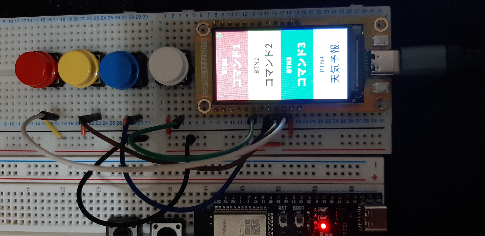

# Muse Gadget SDK 用シグナルボタン

English version: [README.md](README.md).

ESP32 の Muse Gadget に物理ボタンをつなぎ、押すと Muse のチャットに BTN1 などのシグナルを送れるようにするパッチです。自分の Muse に「BTN1 が届いたら天気カードを画面に出して」と指示しておけば、ボタンひとつで呼び出せます。ボタンを増やしたり、使う GPIO を変えたりするときは、Muse が返す設定を変更してガジェットを再起動するだけです。ファームウェアの書き直しは不要です。





## ボタンを押すとどうなるか

ボタンを短押しすると、ガジェットから Link 経由で Muse のチャットに、次のようなメッセージが1件届きます。

```text
[SIG] code=BTN1 press=short seq=1
```

`BTN1` はボタンを識別するコードです。天気カードを表示するなど、コードに対応する動作は、自分の Muse にあらかじめ指示しておきます。指示がなくてもシグナルはチャットに届きます。

`seq` はシグナルの連番で、ガジェットを再起動するとリセットされます。ガジェットはシグナルを送ったあと、Muse の返事を待たずに処理を続けます。

## 使い方

1. Muse Gadget SDK のチェックアウトで `signal_button.patch` を `git apply` で適用します。
2. Kconfig で `CONFIG_HOMEHUB_SIGNAL_BUTTON=y` にして、ファームウェアをビルドして書き込みます。初期設定では無効で、その場合はシグナルボタンのコードは組み込まれません。
3. ボタンを GPIO と GND の間につなぎます。アクティブ Low で、内部プルアップを使うので外付け抵抗は不要です。
4. 自分の Muse に、`BTN1` などのシグナルを受け取ったときに何をするか指示します。

GPIO はボード上で空いているピンを選んでください。ストラッピングピンや、フラッシュ、PSRAM、USB、コンソール、ディスプレイ、ステータス LED などが使うピンは避けます。

詳しい手順は [SETUP.ja.md](https://github.com/mayaakarin/muse-gadget-signal-button/blob/main/SETUP.ja.md) にあります。[muse_setup.ja.md](https://github.com/mayaakarin/muse-gadget-signal-button/blob/main/muse_setup.ja.md) は、自分の Muse にそのまま読ませるためのルールです。

## ボタン1つで使う

起動時にチャットから有効なボタン設定を取得できなかった場合は、ファームウェアに設定した1つのボタンを `BTN1` として使います。これがフォールバックです。

GPIO は `CONFIG_HOMEHUB_SIGNAL_GPIO` で指定します。既定値は GPIO 21 です。Muse 側でボタンの割り当てを設定していなくても、このピンにつないだボタンからシグナルを送れます。

## ボタンを増やす・GPIO を変える

複数のボタンを使う場合は、**どのボタンをどの GPIO につなぐか**を Muse 側に設定します。以降は、配線と Muse が返す設定を変えてガジェットを再起動すれば、新しい割り当てが反映されます。ボタンの追加・削除や GPIO の変更のたびにビルドし直す必要はありません。

起動時に、ガジェットはチャットに設定を問い合わせます。

```text
[SIG] code=CFGREQ seq=1 nonce=XXXXXXXX
```

Muse は、問い合わせに含まれる `nonce` をそのまま使って、`[CFG]` メッセージを1件返します。

```text
[CFG] nonce=XXXXXXXX
01:21,02:47,03:48,04:38
[/CFG]
```

割り当ては `ボタン番号:GPIO番号` の組をカンマで区切って1行に書きます。この例では、GPIO 21 が `BTN1`、GPIO 47 が `BTN2`、GPIO 48 が `BTN3`、GPIO 38 が `BTN4` です。最大32ボタンまで設定でき、割り当ての行は200バイト未満に収めます。

ガジェットは `GET /chat/history` を5秒おきに確認し、最長120秒待ちます。`nonce` が一致する有効な設定を見つけると、その割り当てを使います。設定は RAM に保持し、起動のたびに取り直します。

チャット履歴を使うのは、ガジェットの認証情報では VM 上のファイルを読み出せないためです。`POST /fs/read` は `403` を返しますが、`GET /chat/history` は利用できます。

## 設定と送信の状態を確認する

`device.signal` コマンドで、最後に送ったシグナル、ACK の有無、有効なボタンの数、現在の設定元を確認できます。`config` が `chat` ならチャットから取得した設定、`fallback` ならファームウェアに設定した1ボタン構成です。

どちらの構成でも `BTN1` の押下メッセージは同じです。区別するには `device.signal` の `config` またはガジェットの起動ログを確認してください。`[CFG]` の形式に問題がある場合も、詳細は起動ログに出ます。

## リポジトリの内容

- `signal_button.patch` — SDK の `esp32/main/` 以下にある6ファイル分の変更をまとめたパッチです。
- `muse_signal.c`、`muse_signal.h` — パッチで追加されるソースです。パッチを開かずに読めるよう、個別にも置いてあります。パッチではこのほかに `app.c`、`noise_control.cpp`、`Kconfig.projbuild`、`CMakeLists.txt` を変更します。

このリポジトリには、ガジェット側の実装と Muse に読ませる設定例が入っています。シグナルを受け取って動作するのは、持ち主がペアリングした Muse です。シグナルを受信するための公開 API はありません。

パッチ適用済みの SDK は [mayaakarin/muse-gadget-sdk](https://github.com/mayaakarin/muse-gadget-sdk) にもあります。上流に対して1コミットの差分です。

## 実機で確認した構成

- **ESP32-1732S019** — 170 × 320 ディスプレイ、ボタン4つ。
- **ESP32-S3-DevKitC-1** — ボタン2つ。`[CFG]` の返信を変えて再起動し、再ビルドせずに GPIO の割り当てを変更できることも確認しました。

ベースは上流コミット `8d32b7f`（#477）です。`08e5980`、`e924c05`、`7dd409b` にもパッチをそのまま適用できることを確認しました。SDK を新たにクローンしてパッチを適用・再ビルドし、DevKitC-1 での動作も再確認しています。
