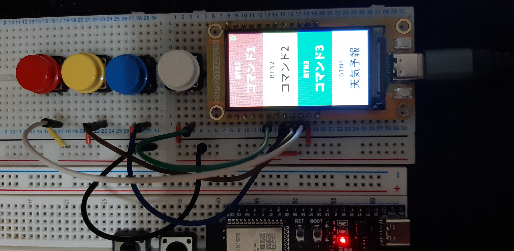

# Signal button for Muse Gadget SDK

This repository holds a small add-on for the Muse Gadget SDK (ESP32
firmware): a **signal button** feature. It contains the change as one patch
file, the two new source files the patch adds, and this explanation.

Contents:

- `signal_button.patch` — the whole change: six files under
  `esp32/main/` of the SDK. Apply it with `git apply` in an SDK checkout.
- `muse_signal.c`, `muse_signal.h` — the two new files, included separately
  so they can be read without opening the patch. (The patch also edits
  `app.c`, `noise_control.cpp`, `Kconfig.projbuild` and `CMakeLists.txt`.)

The same change, applied to the SDK tree, also lives in the fork
[mayaakarin/muse-gadget-sdk](https://github.com/mayaakarin/muse-gadget-sdk)
(one commit on top of upstream).

Japanese version of this document: [README.ja.md](README.ja.md).



## What it does

A physical button wired to the gadget becomes a way to knock on the agent's
door. A press posts one message to the chat over the Link session:

```
[SIG] code=BTN1 press=short seq=N
```

`seq` increases with each press and resets on reboot. The device sends a code
only — what a code *means* is agreed on the agent side (see "The other half"
below). The device also registers a `device.signal` command that reports the
last signal it sent, whether it was acked, how many buttons are active, and
where the button config came from (`chat` or `fallback`).

Signals are send-and-forget: no synchronous reply is needed, the agent acts
when it sees the message.

## Button config is delivered through the chat

The button set is **not compiled in** (one fallback button aside). At boot
the device asks through the chat itself:

```
[SIG] code=CFGREQ seq=1 nonce=XXXXXXXX
```

The agent answers with one `[CFG]` message carrying the same nonce and one
CSV line of `<index>:<GPIO>` pairs:

```
[CFG] nonce=XXXXXXXX
01:21,02:47,03:48,04:38
[/CFG]
```

The device reads the answer back over `GET /chat/history` (polling every
5 s, up to 120 s), matches the nonce, and builds the codes `BTN1`, `BTN2`,
... itself. Up to 32 buttons; the line stays under 200 bytes. Because the
assignment arrives at boot, buttons can be added, removed or swapped between
pins with no reflash — only a reboot and a different `[CFG]` reply.

Why through the chat? The gadget credential cannot read files back from the
VM (`POST /fs/read` returns 403 for this credential's scopes), but the chat
history route is open. The config rides the one channel that works both ways.

## The fallback button

If the config cannot be loaded (no answer, unparseable answer, timeout), the
device falls back to a single button, `BTN1`, on
`CONFIG_HOMEHUB_SIGNAL_GPIO` (default GPIO 21, active low, internal pull-up).
So with zero agent-side setup the device can still knock once; the chat
config is what you add when you want two or more buttons.

## Enabling it

- Set `CONFIG_HOMEHUB_SIGNAL_BUTTON=y` (Kconfig, under the signal button
  entry). Default is off; with it off, none of this code is built in.
- Wire buttons between the chosen GPIOs and GND (active low, internal
  pull-up, no external resistors needed).
- Choose GPIOs that are free on your board: not strapping pins, not
  flash/PSRAM pins, not USB or console pins, and not a pin another
  peripheral (status LED, display, ...) already owns.

## The other half (read this before expecting it to "just work")

This repository contains only the sender. The receiver is the owner's own
paired Muse agent, and there is no public API for it — so this feature
cannot be a complete kit. For a press to do anything, the agent side needs
an agreement, set up by the owner with their agent, covering at least:

- On `CFGREQ`: reply with one `[CFG]` message in the format above, copying
  the nonce, with that device's button line.
- On each `BTN<n>` code: the action agreed for it (draw a card, report the
  weather, ... — the codes carry no meaning by themselves).

Without that setup, presses still arrive in the chat; they just have no
agreed action yet. A setup memo is in [SETUP.md](SETUP.md) (Japanese:
[SETUP.ja.md](SETUP.ja.md)), and the rules file to hand to your own Muse
is [muse_setup.md](muse_setup.md) (Japanese:
[muse_setup.ja.md](muse_setup.ja.md)).

## Known limits

- A fallback `BTN1` press is indistinguishable in the chat from a
  configured `BTN1` press. To tell which mode a device is in, ask
  `device.signal` (its `config` field says `chat` or `fallback`), or read
  the device boot log.
- If the `[CFG]` answer cannot be parsed, the device logs it locally and
  falls back; nothing is reported to the chat.
- Config is held in RAM only and is re-requested on every boot.

## Verified

Device-tested on an ESP32-1732S019 board (170x320 display, 4 buttons) and on
an ESP32-S3-DevKitC-1 (2 buttons, including a pin swap by `[CFG]` alone).
Base: upstream commit `8d32b7f` (#477); the patch also applies cleanly on
`08e5980`, `e924c05` and `7dd409b`. A fresh clone of the SDK plus this patch
was rebuilt and re-verified on the DevKitC-1.
